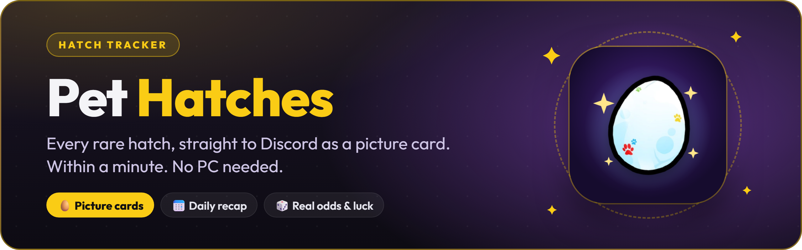
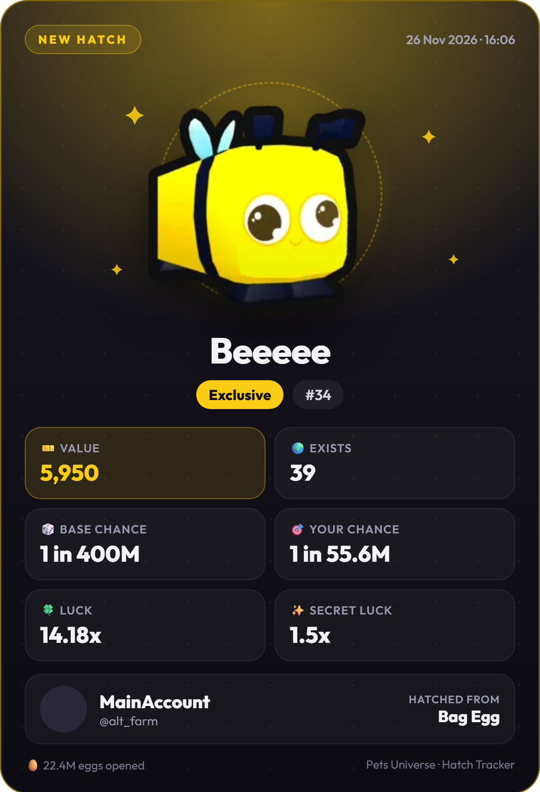
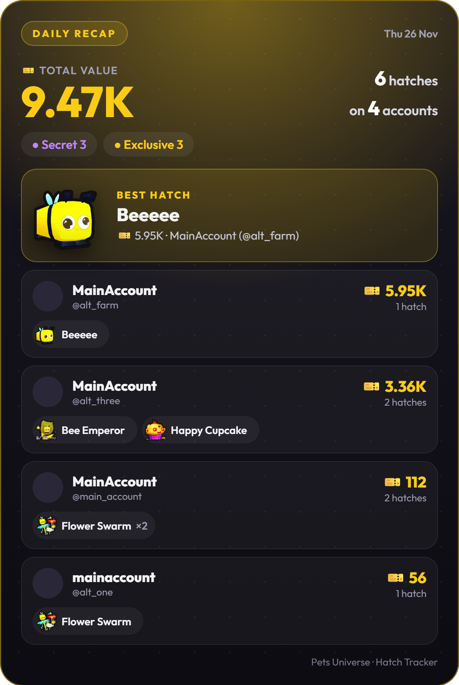
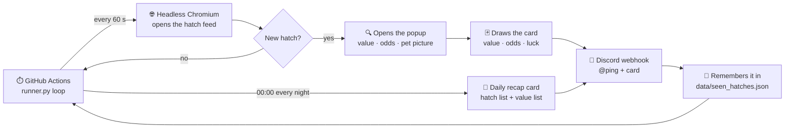

  

  <b>A tiny robot that watches the <a href="https://petsuniverse.org/hatches">Pets Universe hatch feed</a> for my accounts and pings me on Discord the moment something rare comes out of an egg.</b>

  
  
  
  
  

---

## 🆕 What's new

| Date | Update |
|---|---|
| **27 Nov 2026** | 👥 **A second tracker for a friend** (`friend.yml`): his own searches, his own @ping on every hatch and on his daily recap, separate from yours. `HATCH_QUERY` can now hold several searches split by `\|`, e.g. `NameA\|NameB` |
| **27 Nov 2026** | 🤖 **Want your own?** Send the repo link to any AI chatbot and ask it to set it up: there's now a step-by-step guide written for it |
| **27 Nov 2026** | 📅 The daily recap now counts **every** hatch of the day, however many there are (it used to stop at the site's newest 60) |
| **26 Nov 2026** | 🃏 **Picture cards**: every hatch alert and the daily recap are now a designed card instead of plain text |
| **26 Nov 2026** | 🎲 Real odds from the site: **base chance**, **your own chance**, **luck** and **secret luck** (`???` when the odds are unknown) |
| **26 Nov 2026** | 🚦 Handles bursts: 4 Secrets in the same minute all arrive, even if Discord asks to slow down |
| **26 Nov 2026** | 📅 **Daily recap** every night at 00:00: what each account hatched that day and how much it's all worth |
| **23 Nov 2026** | 🖼️ Every pet now shows its real picture, even the ones the site hides behind protected links |
| **23 Nov 2026** | 🧪 Test several different pets at once with `preview_count` |

## 🥚 What it does

You're grinding eggs, you step away for a snack, and *of course* that's when the 1-in-133-million pet drops.
This repo makes sure you never miss it.

- 👀 **Watches** the public hatch feed every **60 seconds**
- 🎉 **Pings you** in a Discord channel for every new hatch on any of your accounts
- 🃏 Sends a **picture card** for every hatch: the pet, its value, how many exist, the odds, your luck and the account
- 📅 Posts a **daily recap** at midnight: every hatch per account, plus the **total value** you made that day
- 📱 Runs **100% in the cloud** on GitHub Actions. No PC, no server, works while you sleep

## 🃏 What an alert looks like

Every hatch arrives as one card, coloured by rarity (purple for Secret, gold for Exclusive):

  

| Tile | What it shows |
|---|---|
| 🎫 **Value** | the pet's value on the site (the same number as when you tap the hatch) |
| 🌍 **Exists** | how many of this pet exist |
| 🎲 **Base chance** | the pet's normal odds, or `???` when nobody knows them |
| 🎯 **Your chance** | your odds with all your boosts (only when it differs from the base chance) |
| 🍀 **Luck** · ✨ **Secret luck** | the luck you had when it dropped (only for hatches that have it) |

Below that: your Roblox avatar and account, and which egg it came from.
If a card ever can't be drawn, the alert is still sent as text, so you never miss a hatch.

## 📅 The daily recap

Every night just after **00:00** (Stockholm time), one message sums up the day that just ended:

- 🥚 how many rare pets hatched, and on how many accounts
- 🎫 the **total value** of everything you hatched, using the same **Value** the site shows when you tap a hatch (the exact variant, so Rainbow and BIG pets get their own price)
- 🏆 the best hatch of the day
- 👤 a breakdown per account with its avatar: which pets (with their icons), how many, and what they're worth

  

The recap reads the site's own public hatch and value lists, so it's fast and exact to the second. A pet without a price yet is shown as *"no price yet"*, never guessed.
If the tracker happens to be offline at midnight, it catches up later that morning. It never posts the same day twice.

## ⚙️ How it works

- The site is rendered with JavaScript, so a real (headless) browser reads it via **Playwright**.
- A job lives ~6 hours, then **starts its own next run**, so the watch never stops. A backup cron restarts it if anything goes wrong.
- Every hatch it has already announced is saved back to the repo, so nothing is ever pinged twice, even across restarts.

## 🚀 Run your own

1. **Fork** this repo (keep it **public**: public repos get unlimited free Actions minutes).
2. In Discord: *Channel settings → Integrations → Webhooks → New webhook*, then copy the URL.
3. In your fork: *Settings → Secrets and variables → Actions*, and add:

   | Secret | What to put |
   |---|---|
   | `DISCORD_WEBHOOK_URL` | the webhook URL from step 2 |
   | `HATCH_QUERY` | the name you search for on the hatch page |
   | `DISCORD_USER_ID` | your Discord user ID (for the @ping) |

4. *Actions → tracker-runner → Run workflow*. The first run quietly remembers your existing hatches and posts **"Hatch tracker is running"**.

### 🧪 Test it

Run the workflow with **preview** ticked to get a sample alert right away.
Set **preview_count** (1-10) to test several *different* pets in one go. Handy for checking that every pet's picture shows up.
Tick **recap** instead to get a recap of the **last 24 hours** right now.

## 📁 What's inside

| File | Job |
|---|---|
| `hatch.py` | reads the feed, opens popups, finds the pet picture, sends the alerts |
| `card.py` | draws the picture cards (a small web page rendered by the browser, saved as an image) |
| `recap.py` | the daily recap: collects the day's hatches, prices them and posts the recap card |
| `runner.py` | the long-running loop: check, save state, recap at midnight, hand over to the next run |
| `.github/workflows/hatches.yml` | the GitHub Actions workflow (`tracker-runner`) |
| `data/seen_hatches.json` | hatches already announced |
| `data/recap_state.json` | the last day a recap was posted for |
| *hatch log* | every hatch with its time, for the recap. Kept in GitHub's **private Actions cache**, not in the repo, since it lists every account |

## 🤖 Want this for yourself? Ask an AI to set it up

You don't need to know how to code. Open any AI chatbot (ChatGPT, Claude, Gemini…), paste the link to this page and say:

> **"I want this set up for me. Please guide me step by step."**

The chatbot reads the guide below and walks you through it, one click at a time. It takes about 10 minutes, it's free, and you don't need a PC running: everything runs on GitHub.

### 📋 Setup guide for AI assistants

*This part is written for the AI chatbot helping someone set up their own copy. If you're a person, you can follow it too.*

**What this is:** a Pets Universe (Roblox) hatch tracker. Every minute it checks https://petsuniverse.org/hatches for the user's accounts and posts each rare hatch to their Discord as a picture card, plus a daily recap card at 00:00. It runs for free on GitHub Actions in the user's own copy of this repo.

**Ask the user:**
1. **Their search word.** Have them open https://petsuniverse.org/hatches and type a word in the search box (a username, a display name, or a part that all their accounts share). It's right when the list shows **only their** accounts' hatches. This becomes `HATCH_QUERY`.
2. **A Discord channel** where the alerts should go (they'll make a webhook for it).
3. *(optional)* **Their Discord user ID**, if they want an @ping on every hatch. Discord → Settings → Advanced → turn on **Developer Mode**, then right-click their own name → **Copy User ID**.

**How to guide the user (they are usually not technical, often on a phone):**
- Go **one step at a time**. Give the exact button names and wait for them to confirm before moving on.
- Ask for the information in the "Ask the user" list first, then do the steps in order.
- **Never ask them to paste their Discord webhook URL into the chat.** It is a password: they paste it only into the GitHub secret box. If they already shared it somewhere public, have them delete the webhook and make a new one.
- They should **not edit any `.py` file**. Everything is set through secrets and the settings block in the workflow file.
- The repo must stay **public**. Public repos get unlimited free GitHub Actions minutes; this tracker runs 24/7 and would use up a private repo's free minutes in a couple of days. Secrets stay private in a public repo.

**Steps**
1. **GitHub account:** sign up free at https://github.com if they don't have one.
2. **Fork:** on this repo's page tap **Fork → Create fork**. Keep it public.
3. **Remove the original owner's memory** (otherwise the first run gets confused by someone else's hatches): in the fork, open `data/seen_hatches.json` → **⋯ → Delete file → Commit changes**. Do the same for `data/recap_state.json`.
4. **Webhook:** create one in the chosen Discord channel (see below) and copy it.
5. **Secrets** (see below), in the fork:

   | Secret name | Value | Needed? |
   |---|---|---|
   | `DISCORD_WEBHOOK_URL` | the webhook URL | **yes** |
   | `HATCH_QUERY` | the search word from question 1 | **yes** |
   | `DISCORD_USER_ID` | their Discord user ID | optional (for the @ping) |

   Other secrets you may see mentioned in the workflow (`FLOWER_WEBHOOK_URL`, `HATCH_LOG_SEED`) are **not needed**. Leave them out.

**Enable and start it**
- In the fork, open the **Actions** tab. GitHub disables workflows in forks, so click **"I understand my workflows, go ahead and enable them"**.
- Then go to **Actions → tracker-runner → Run workflow** (on a phone, use "Desktop site" in the browser if the button is missing).
- After that it runs by itself: each run lasts about 6 hours and then starts the next one, and a backup timer restarts it if it ever stops. Nothing to keep open.

**What they should see**
- Within ~3 minutes: **"✅ Hatch tracker is running"** in Discord. The first run only remembers their existing hatches; it doesn't post old ones.
- From then on: a picture card within about a minute of every rare hatch, and a **daily recap** shortly after 00:00.
- To test right away: **Run workflow** with **preview** ticked (a sample card of their newest hatch) or **recap** ticked (a recap of the last 24 hours).

**If something's wrong**
- *Nothing in Discord:* open **Actions**, click the latest run, and read the red error. Usually a secret name is misspelled or the webhook URL was cut off. "HATCH_QUERY and DISCORD_WEBHOOK_URL secrets are required" means one of the two is missing.
- *Other people's hatches show up:* the search word is too broad. Pick a more specific one and update the `HATCH_QUERY` secret.
- *Times look an hour or more off:* everything runs on **Stockholm time**. The line `TZ = ZoneInfo("Europe/Stockholm")` near the top of the `.py` files sets it. That line is the **only** code change worth making. Swap in their own zone, e.g. `America/New_York`, in every file that has it.

**Discord webhook (where the posts go)**
- Discord: right-click the channel (on a phone: long-press) → **Edit Channel → Integrations → Webhooks → New Webhook → Copy Webhook URL**. This needs "Manage Webhooks" permission on the server.
- Optional bot picture: in the same webhook screen, upload `assets/avatar.png` from this repo and give it a name.

**Adding a secret on GitHub**
- In the fork: **Settings → Secrets and variables → Actions → New repository secret**. The name must match exactly (capital letters, underscores).

**Editing the settings block**
- Open the workflow file on github.com, tap the **pencil icon**, change only the values between the quotes, then **Commit changes**.

---

Fan-made side project. Not affiliated with Pets Universe or Roblox. Built with ☕ and a lot of eggs.

