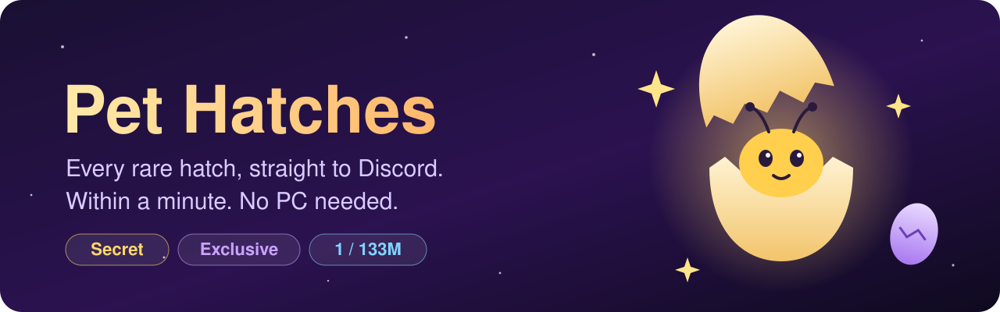
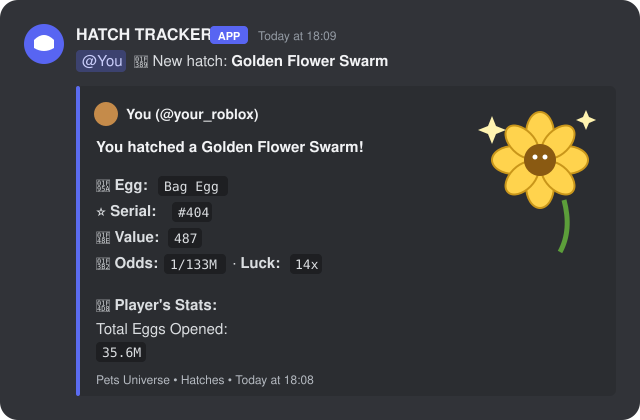
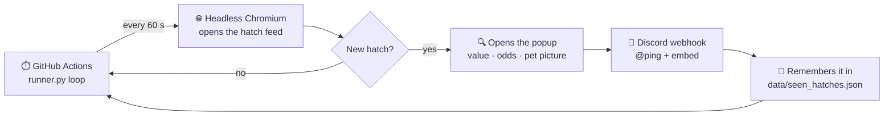

  

  <b>A tiny robot that watches the <a href="https://petsuniverse.org/hatches">Pets Universe hatch feed</a> for my accounts and pings me on Discord the moment something rare comes out of an egg.</b>

  
  
  
  

---

## 🥚 What it does

You're grinding eggs, you step away for a snack, and *of course* that's when the 1-in-133-million pet drops.
This repo makes sure you never miss it.

- 👀 **Watches** the public hatch feed every **60 seconds**
- 🎉 **Pings you** in a Discord channel for every new hatch on any of your accounts
- 🖼️ Shows the **pet's picture**, the egg, serial, value, odds and luck, just like the game's own bot
- 📱 Runs **100% in the cloud** on GitHub Actions. No PC, no server, works while you sleep

## 📸 What an alert looks like

  

## ⚙️ How it works

- The site is rendered with JavaScript, so a real (headless) browser reads it via **Playwright**.
- A job lives ~6 hours, then **starts its own next run**, so the watch never stops. A backup cron restarts it if anything goes wrong.
- Every hatch it has already announced is saved back to the repo, so nothing is ever pinged twice, even across restarts.

## 🚀 Run your own

1. **Fork** this repo (keep it **public**: public repos get unlimited free Actions minutes).
2. In Discord: *Channel settings → Integrations → Webhooks → New webhook*, then copy the URL.
3. In your fork: *Settings → Secrets and variables → Actions*, and add:

   | Secret | What to put |
   |---|---|
   | `DISCORD_WEBHOOK_URL` | the webhook URL from step 2 |
   | `HATCH_QUERY` | the name you search for on the hatch page |
   | `DISCORD_USER_ID` | your Discord user ID (for the @ping) |

4. *Actions → tracker-runner → Run workflow*. The first run quietly remembers your existing hatches and posts **"Hatch tracker is running"**.

### 🧪 Test it

Run the workflow with **preview** ticked to get a sample alert right away.
Set **preview_count** (1-10) to test several *different* pets in one go. Handy for checking that every pet's picture shows up.

## 📁 What's inside

| File | Job |
|---|---|
| `hatch.py` | reads the feed, opens popups, finds the pet picture, builds the Discord embed |
| `runner.py` | the long-running loop: check, save state, repeat, hand over to the next run |
| `.github/workflows/hatches.yml` | the GitHub Actions workflow (`tracker-runner`) |
| `data/seen_hatches.json` | hatches already announced |

---

Fan-made side project. Not affiliated with Pets Universe or Roblox. Built with ☕ and a lot of eggs.

