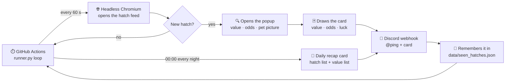

  

  <b>A tiny robot that watches the <a href="https://petsuniverse.org/hatches">Pets Universe hatch feed</a> for my accounts and pings me on Discord the moment something rare comes out of an egg.</b>

  
  
  
  
  

---

## 🆕 What's new

| Date | Update |
|---|---|
| **26 Nov 2026** | 🃏 **Picture cards**: every hatch alert and the daily recap are now a designed card instead of plain text |
| **26 Nov 2026** | 🎲 Real odds from the site: **base chance**, **your own chance**, **luck** and **secret luck** (`???` when the odds are unknown) |
| **26 Nov 2026** | 🚦 Handles bursts: 4 Secrets in the same minute all arrive, even if Discord asks to slow down |
| **26 Nov 2026** | 📅 **Daily recap** every night at 00:00: what each account hatched that day and how much it's all worth |
| **23 Nov 2026** | 🖼️ Every pet now shows its real picture, even the ones the site hides behind protected links |
| **23 Nov 2026** | 🧪 Test several different pets at once with `preview_count` |

## 🥚 What it does

You're grinding eggs, you step away for a snack, and *of course* that's when the 1-in-133-million pet drops.
This repo makes sure you never miss it.

- 👀 **Watches** the public hatch feed every **60 seconds**
- 🎉 **Pings you** in a Discord channel for every new hatch on any of your accounts
- 🃏 Sends a **picture card** for every hatch: the pet, its value, how many exist, the odds, your luck and the account
- 📅 Posts a **daily recap** at midnight: every hatch per account, plus the **total value** you made that day
- 📱 Runs **100% in the cloud** on GitHub Actions. No PC, no server, works while you sleep

## 🃏 What an alert looks like

Every hatch arrives as one card, coloured by rarity (purple for Secret, gold for Exclusive):

  

| Tile | What it shows |
|---|---|
| 🎫 **Value** | the pet's value on the site (the same number as when you tap the hatch) |
| 🌍 **Exists** | how many of this pet exist |
| 🎲 **Base chance** | the pet's normal odds, or `???` when nobody knows them |
| 🎯 **Your chance** | your odds with all your boosts (only when it differs from the base chance) |
| 🍀 **Luck** · ✨ **Secret luck** | the luck you had when it dropped (only for hatches that have it) |

Below that: your Roblox avatar and account, and which egg it came from.
If a card ever can't be drawn, the alert is still sent as text, so you never miss a hatch.

## 📅 The daily recap

Every night just after **00:00** (Stockholm time), one message sums up the day that just ended:

- 🥚 how many rare pets hatched, and on how many accounts
- 🎫 the **total value** of everything you hatched, using the same **Value** the site shows when you tap a hatch (the exact variant, so Rainbow and BIG pets get their own price)
- 🏆 the best hatch of the day
- 👤 a breakdown per account with its avatar: which pets (with their icons), how many, and what they're worth

  

The recap reads the site's own public hatch and value lists, so it's fast and exact to the second. A pet without a price yet is shown as *"no price yet"*, never guessed.
If the tracker happens to be offline at midnight, it catches up later that morning. It never posts the same day twice.

## ⚙️ How it works

- The site is rendered with JavaScript, so a real (headless) browser reads it via **Playwright**.
- A job lives ~6 hours, then **starts its own next run**, so the watch never stops. A backup cron restarts it if anything goes wrong.
- Every hatch it has already announced is saved back to the repo, so nothing is ever pinged twice, even across restarts.

## 🚀 Run your own

1. **Fork** this repo (keep it **public**: public repos get unlimited free Actions minutes).
2. In Discord: *Channel settings → Integrations → Webhooks → New webhook*, then copy the URL.
3. In your fork: *Settings → Secrets and variables → Actions*, and add:

   | Secret | What to put |
   |---|---|
   | `DISCORD_WEBHOOK_URL` | the webhook URL from step 2 |
   | `HATCH_QUERY` | the name you search for on the hatch page |
   | `DISCORD_USER_ID` | your Discord user ID (for the @ping) |

4. *Actions → tracker-runner → Run workflow*. The first run quietly remembers your existing hatches and posts **"Hatch tracker is running"**.

### 🧪 Test it

Run the workflow with **preview** ticked to get a sample alert right away.
Set **preview_count** (1-10) to test several *different* pets in one go. Handy for checking that every pet's picture shows up.
Tick **recap** instead to get a recap of the **last 24 hours** right now.

## 📁 What's inside

| File | Job |
|---|---|
| `hatch.py` | reads the feed, opens popups, finds the pet picture, sends the alerts |
| `card.py` | draws the picture cards (a small web page rendered by the browser, saved as an image) |
| `recap.py` | the daily recap: collects the day's hatches, prices them and posts the recap card |
| `runner.py` | the long-running loop: check, save state, recap at midnight, hand over to the next run |
| `.github/workflows/hatches.yml` | the GitHub Actions workflow (`tracker-runner`) |
| `data/seen_hatches.json` | hatches already announced |
| `data/recap_state.json` | the last day a recap was posted for |

---

Fan-made side project. Not affiliated with Pets Universe or Roblox. Built with ☕ and a lot of eggs.

